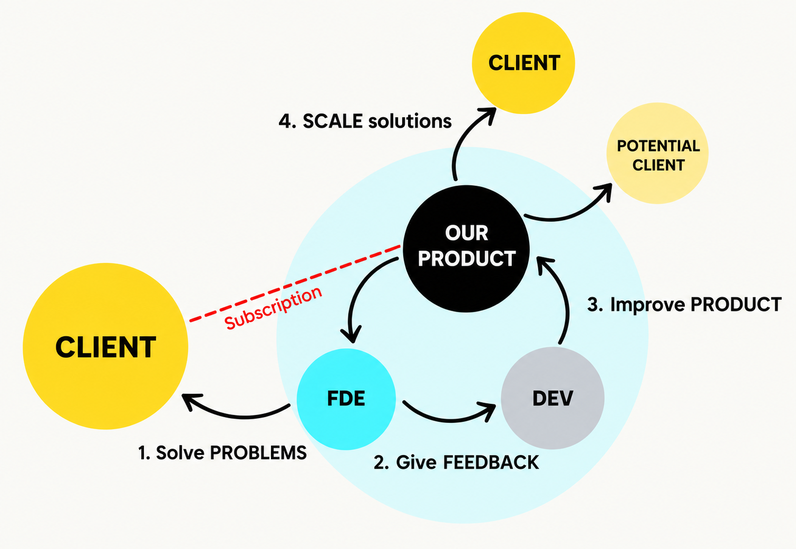

# Jonathan Oktaviano Frizzy

Engineer, farmer and open-source builder working across intelligent systems, embedded software, optimisation, and practical engineering tools.

I enjoy turning complex technical ideas into small, inspectable systems: a model with explicit assumptions, an interface that is easy to test, and documentation that helps the next engineer reproduce the result.

## Selected work

- [Text Embedding](https://github.com/robotjaol/text-embedding) — an open-source playground for exploring text embeddings, semantic representations, and NLP workflows.
- [Route Optimization](https://github.com/robotjaol/last-mile-route-optimization) — screening-level industrial load and route simulations.
- [Vision Transformer Study](https://github.com/robotjaol/vit) — readable ViT implementations and a learning notebook.
- [DeepThink Gamma](https://github.com/robotjaol/deepthink-gamma) — an experimental open-source framework for structured AI reasoning, and research. exploration.
- [SpaceX Personal Research](https://github.com/robotjaol/spacex-research) — Independent aerospace research connecting public SpaceX sources with engineering models.
- [STM32 IMU Board](https://github.com/robotjaol/stm32_imu_board) — an embedded hardware platform integrating STM32-based processing with inertial sensing for motion and robotics experimentation.

## Engineering principles (First principles thinking)

- Make assumptions, units, and safety boundaries visible.
- Prefer reproducible experiments over unexplained results.
- Keep interfaces small and components replaceable.
- Treat documentation, tests, and operational constraints as part of the design.
- Share useful building blocks without exposing confidential project details.

## How I work

  

## Current interests

Internal Reward Development, Ontology, Risk management, Automation & Digitalization, PLC, DCS/SCADA, machine learning, embedded Linux, Supply Chain, real-time systems, computer vision, and sustainable infrastructure.

Browse the pinned repositories below for the most representative projects. Issues and focused pull requests are welcome in repositories that include contribution guidance. 

email: robotjaol@gmail.com
